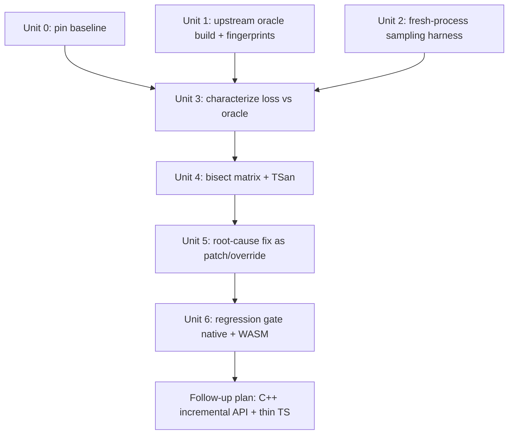

# fix: Non-deterministic / lossy realization in native Konclude port

## Overview

The first realization of a fresh reasoner on `tests/fixtures/roberts-family.nt` loses a random amount of inferences (up to 13%). Pristine upstream Konclude (real Qt, no additions) does not. This plan (1) builds an upstream oracle and a fresh-process sampling harness, (2) characterizes *what* is lost, (3) bisects our additions to find the cause, (4) fixes it via patch/override, and (5) gates regressions natively and in WASM. The structural goal (Konclude C++ owns incremental classify + realize on a kept-alive reasoner; TS layer shrinks to N3 store integration/persistence) is deliberately **split out** into a follow-up plan that depends on this one (see Scope Boundaries).

This plan is a **prerequisite** for `docs/plans/2026-10-08-001-fix-incremental-realization-sequential-calls-plan.md` Phase B (incremental fast path) and for the follow-up incremental-API plan. Building incremental reuse on a realization that is itself non-deterministic would make every later regression undiagnosable.

## Problem Frame

Evidence gathered 2026-10-08 (native debug build, `-O1 -g3`, 8 threads, Roberts family):

| Build | Measurement | Result |
| --- | --- | --- |
| Pristine upstream Qt build (`git archive` of vendor HEAD, only `.pro`/`.pri` path fixes, system librdf) | `isRelationOf` role closure via SPARQL, 4 runs | 157,610 answers, 4/4 identical |
| Pristine upstream | class assertions via `realization` command, 6 runs | 4957 or 4958; only `PersonWithManySibling` flips (about 1 in 5000) |
| Pristine upstream | `-w 1` | hangs at 0% CPU (upstream bug; ignore) |
| Our port (`build-native/konclude_repro`) | first realization, 5 fresh processes | 353335 / 352998 / **308319** / 352081 / 353321 triples; complete is about 353337 |
| Our port, `reload`, `reload-split` modes | 4 runs each | random every run, including run 1; split is not better (one run 337695) |
| Our port, `reuse` mode | runs 2-4 | identical, but only because they re-read the already-realized ontology; **not independent samples** |

Reading: the lost inferences are non-deterministic, not tied to reset/reload and not tied to submitting classify and realize in one requirement list. One run matched upstream within one triple (`isRelationOf` 157,609 vs 157,610), so the logic is right when it completes; something loses work. Role closure uses the genuine OPSROLEREALIZE step (`CReasonerManagerThread.cpp` requests it for any realization query that needs roles), same as our `addReq(OPSROLEREALIZE)` in `src/KoncludeReasoner.cpp`. Not an invented path.

Our build differs from upstream in these ways (the suspect set): Qt container shim (`src/compat/QtCompat.h`), eleven overrides in `src/compat/overrides/` (threading, managers, classification, callback data), vendor patches in `patches/` (pthread correctness 002, cache sync/no-thread 003, KPSet determinism 008, destructors 005, etc.), sync-mode event queues, `loadNTriplesStr`/Redland model construction instead of upstream's parser loader, glibc malloc natively (mimalloc in WASM), and our own output extraction path.

## Requirements Trace

- R1. A reproducible oracle for Roberts (and at least one small ontology) built from pristine upstream, with enough fidelity to detect the loss: per-property role-assertion counts and canonical hashes plus class assertions.
- R2. A harness that samples *fresh processes* (not repeated calls) and reports pass/fail by comparison with the oracle, exit code nonzero on mismatch/hang.
- R3. Characterize the loss (which properties, which individuals, which pipeline step) before bisecting.
- R4. Identify the responsible addition(s) by controlled variants with statistically meaningful sample counts.
- R5. Fix at root cause using the repo's patch workflow; no edits to `vendor/konclude/` directly.
- R6. Regression gate: role-assertion fingerprint equals the oracle exactly across N fresh processes (N derived from the measured baseline loss rate), class assertions differing only within the known-flake set; plus a multi-process WASM-level check; both wired to a make target.
- R7 (follow-up plan, not in this plan). Konclude C++ API supports incremental classify/realize on a kept-alive reasoner; TS layer only maps quads to/from the N3 store (user's stated structural goal). This plan exists to make that safe.

## Scope Boundaries

- Not chasing the upstream class-assertion flake (`PersonWithManySibling`, about 1 in 5000) — treated as accepted upstream noise; oracle comparison tolerates exactly that known set.
- Not fixing upstream `-w 1` hang.
- No performance work (port is about 40 s at `-O1` vs upstream about 93 s for one role; comparable once roles are materialized).
- No new OWL 2 DL conformance work (separate parity plans).

### Deferred to Separate Tasks

- Incremental C++ API, TBox fingerprint, state reuse, and the thin-TS-layer restructure (R7): follow-up plan, to be written after Unit 6 and sequenced with `docs/plans/2026-10-08-001-fix-incremental-realization-sequential-calls-plan.md` Phase B (which owns the TBox fingerprint and fast-path research). It must define the API contract (method list, load/classified/realized/dirty state machine, invalidation rules) and a go/no-go: each incremental scenario deterministic over N fresh processes before the TS reset+reload fallback is removed (commit `a978980` removed `canReuse` for stability).
- Async→sync audit of the 6 remaining cache CThreads (tracked in memory `project_async_audit_task`).

## Context & Research

### Relevant Code and Patterns

- `src/native_repro.cpp` and `native/CMakeLists.txt` — current harness and `konclude_repro` target; modes `reload`, `reload-split`, `reuse`; `resultAsSortedNTriples()` in `src/KoncludeReasoner.cpp` (native-only).
- `src/debug_harness.cpp` — older 8-call sequential reproducer (state dumps).
- `src/KoncludeReasoner.cpp` — `runPipeline`, `buildInferredTripleBuffer`, `buildPropertyTripleBuffer`, role visitors around the `CRoleRealization` walk.
- `src/compat/overrides/` — eleven overrides; `patches/ENABLED` — ordered patch list; `scripts/apply-patches.sh`, `scripts/new-multi-file-patch.sh`.
- Pristine upstream recipe (not in repo yet): `git archive HEAD` of `vendor/konclude`, replace `\X` path separators in `Konclude.pri`, drop bundled static libs and jemalloc in the `.pro`, add system `librdf/raptor2/rasqal`, a `Redland.h` -> `redland.h` shim include dir, flags `-g3 -O1 -fno-omit-frame-pointer`.
- Upstream CLI: `Konclude realization -w N -i file.nt -o out.xml` (class assertions only); `Konclude sparqlfile -i file.nt -s q.sparql -o out` for role closure (dynamic realization path).

### Institutional Learnings

- `docs/solutions/debugging/sequential-call-object-lifecycle.md`, `docs/solutions/architecture-patterns/wasm-threading-model-invariants.md`, `wasm-pthread-concurrency-architecture-2026-05-08.md` — threading invariants to check against bisect results.
- Memory notes: fflush(stderr) deadlocks pthreads; never patch without logging; build from known-good source; Konclude item lifecycle paradigm; graphify mandatory before any C++ patch.

### External References

- None. Local pattern coverage is strong; no external research needed.

## Key Technical Decisions

- **Sample fresh processes, never repeated calls**: realization is cached after the first call, so only process-level samples are independent. Rationale: reuse mode gave a misleading "PASS".
- **Characterize before bisecting** (Unit 3 precedes Unit 4): the loss pattern (which roles, which individuals, at which step) can eliminate half the suspect list for free.
- **Oracle committed as compact fingerprints, not full dumps**: per-property count plus sorted-triple SHA-256 in JSON under `tests/fixtures/`; full dumps regenerate into `/tmp`. Rationale: disk pressure (root disk filled earlier), repo size.
- **Pass criterion**: role-assertion fingerprint equals oracle exactly (upstream role closure has been 4/4 stable); class assertions may differ only on the known flake set. Output canonicalized to collapse equivalent-property representatives (hasChild/isParentOf style synonyms).
- **Forward bisect only, via compile-time switches in ONE patched tree**: overrides cannot be swapped back to vendor sources natively (vendor needs Qt), and patches 000-016 apply strictly in order against one shared `vendor/konclude` tree guarded by one `.patches-applied` sentinel, so dropping a middle patch or building variants in parallel build dirs does not work. Variants are therefore `-D` / `#ifdef` switches (added by one new patch plus the overrides) over a single patched tree, built serially by one driver; if a variant truly needs a different patch stack, it gets its own `vendor` worktree copy with its own sentinel. TSan on the native build is the first, toggle-free step.
- **Pin the baseline first (Unit 0)**: `patches/ENABLED` lists 000-009 and 011; 010 and 012-016 are untracked and skipped by the apply script. Every measurement records the active patch list and the vendor diff hash.
- **Extraction path is a suspect, not a given**: our own readout (`buildPropertyTripleBuffer`, role visitors, `resultAsSortedNTriples`) may race the realizer; Unit 3 discriminates this first.
- **Oracle semantics are defined before gating**: which side's triple set is normative (SPARQL answer set per property), exact canonicalization (inverse/equivalent representatives, blank nodes, asserted vs inferred), and the known 157,609 vs 157,610 delta explained or recorded as tolerated.
- **Sample counts come from the measured loss rate**: rule-of-three style (about 60 clean samples bound a residual failure rate to 5% at 95%), a smaller reproducing ontology for cheap high N, and a CPU-load amplifier.
- **WASM loss is measured early** (fresh Node process per sample) so the premise 'WASM is affected like native' is established before the native fix, not after.
- **Fix via patch or override per CLAUDE.md decision rule**, with graphify (`graphify explain`/`path`) before reading or editing C++.
- **Incremental restructure comes last** and reuses plan 001 research units; the C++ layer exposes explicit load/update/classify/realize/read operations with idempotent cached results, so TS cannot reintroduce orchestration logic.

## Open Questions

### Resolved During Planning

- Is the loss a TS/WASM artifact? No — reproduced natively without TS or WASM.
- Is the role path invented by us? No — same OPSROLEREALIZE step upstream requests for role queries.
- Is the combined classify+realize requirement list the cause? No — split mode is at least as bad.

### Deferred to Implementation

- Which addition causes the loss (Units 3-4 decide). Candidate classes: data race in an override or sync-mode queue; premature "processing complete" signalling in manager overrides (`CPrecomputationManager`, `CClassificationManager`, completion callbacks); `QHash`->`unordered_map` iterator invalidation; incomplete drain of realizer messages (`COntologyRealizingDynamicRequirmentCallbackData` override).
- Exact oracle path for roles in a like-for-like eager mode (OWLlink `GetObjectPropertyTargets` for all individuals vs SPARQL per property) — pick whichever is cheaper once Unit 1 exists; SPARQL is already validated for `isRelationOf`.
- Whether glibc-vs-mimalloc changes the loss rate (run WASM-side sampling after the native fix).

## High-Level Technical Design

> *This illustrates the intended approach and is directional guidance for review, not implementation specification. The implementing agent should treat it as context, not code to reproduce.*

Bisect decision logic (per variant, N fresh processes):

| Outcome over N samples | Meaning |
| --- | --- |
| All equal oracle | Variant removes the cause (or masks it: raise N / add load) |
| Varying counts | Cause still present |
| Always the same wrong count | Deterministic logic loss — different class of bug (not a race) |

## Implementation Units

> **Progress 2026-10-08:** Units 0-2 done. Key finding: of 47 oracle buckets, 46 role buckets match upstream in all 5 samples; ONLY `isRelationOf` (top super-role) varies (-1 / -314 / -1222 / -45019). `isBloodRelationOf` has a constant -1 (reflexive pair `john_william_folland`, deterministic, recorded as known delta). `__types__` is not gated (upstream itself flakes 4957/4958; port counts rdf:type differently, 4608 vs ~4957). Unit 3 should focus on sub->super role propagation into `isRelationOf` (symmetric, super-role of isBloodRelationOf/isInLawOf ...), not generic realization.

### Phase A — Evidence tooling

- [x] **Unit 0: Pin the baseline**

**Goal:** One well-defined patch/source state for all measurements.

**Requirements:** R4

**Dependencies:** None

**Files:**
- Modify: `patches/ENABLED` (decide which of 009-016 are enabled; record rationale)
- Modify: `scripts/repro-sample.sh` (Unit 2) to print active patch set, commit and dirty state per sample
- Test: Test expectation: none -- baseline bookkeeping

**Approach:** Triage untracked patches 010, 012-016 and modified `src/` files (commit or park them); re-measure the loss distribution on the pinned baseline (5+ fresh samples) and on committed HEAD (patches 000-008 only) so the first bisect rows exist. Note ENABLED matching is substring-based and line order differs from apply order (filename order).

**Verification:** Baseline patch list and vendor diff hash recorded; loss distribution known for HEAD and for the current working set.

- [x] **Unit 1: Upstream oracle (build recipe + fingerprint generator)**

**Goal:** Reproducible pristine-upstream build and a compact golden fingerprint for Roberts (and one small ontology).

**Requirements:** R1

**Dependencies:** None

**Files:**
- Create: `scripts/oracle/build-upstream.sh` (documents/automates the export + path-fix + system-lib `.pro` recipe into a directory outside the repo, e.g. a user cache dir; checks free disk first)
- Create: `scripts/oracle/gen-oracle.py` (runs upstream: `realization` for class assertions; `sparqlfile` for every declared object property; canonicalizes; writes fingerprint JSON)
- Create: `tests/fixtures/oracle/roberts-family.oracle.json` (per-property counts, sorted-triple SHA-256, class assertion count and hash, known-flake note)
- Test: `tests/unit/oracle-fingerprint.test.ts` (fixture schema sanity only)

**Approach:**
- Canonicalization rules shared with Unit 2: collapse equivalent/inverse property representatives, sort, dedupe, ignore blank-node ids.
- Run each upstream query at least 5 times at generation (also once under CPU load); record disagreement as the tolerated flake set. Check whether the upstream class flake resembles entries in our lost set (Unit 3).
- **Mandatory cross-check** (was optional): validate SPARQL oracle against an independent eager route (OWLlink object-property query for all individuals) on one small ontology and Roberts, for every property, and show our best complete run (353,337 triples) matches on every property, not only `isRelationOf`. Explain the 157,609 vs 157,610 delta or record it as a tolerated delta.
- Dump full triples only to `/tmp`; commit fingerprints only.
- Verify `isRelationOf` = 157,610 reproduces.

**Patterns to follow:** existing fixtures naming in `tests/fixtures/` (`roberts-native-*`); `scripts/*.sh` style.

**Test scenarios:**
- Happy path: generator on Roberts reproduces `isRelationOf` = 157,610 and writes valid JSON.
- Edge case: property with zero answers recorded as count 0, not omitted.
- Error path: upstream binary missing -> clear message and nonzero exit; disk below threshold -> refuses to build.
- Integration: fingerprint file parsed by Unit 2's comparer.

**Verification:** Oracle JSON committed; regenerating twice yields identical role fingerprints.

- [x] **Unit 2: Fresh-process sampling harness**

**Goal:** One command that runs N independent processes of our native reasoner and compares each to the oracle.

**Requirements:** R2

**Dependencies:** Unit 1 (comparison), existing `src/native_repro.cpp`

**Files:**
- Modify: `src/native_repro.cpp` (emit canonical fingerprint JSON instead of raw sorted NT only; keep raw dump behind a flag; add per-step counters hook for Unit 3)
- Create: `scripts/repro-sample.sh` (loops N fresh processes, collects JSON, summarizes distribution, exit code nonzero on mismatch/hang)
- Create: `scripts/compare-fingerprint.py` (our JSON vs oracle JSON; reports missing/extra per property)
- Modify: `Makefile` (target `repro` / `repro-sample`)
- Test: `tests/unit/compare-fingerprint.test.ts`

**Approach:**
- `reuse` mode relabeled: its repeated realizations are labelled "cache re-read", not samples. Only process-level samples count.
- Watchdog abort stays (core for gdb); disk-aware: delete per-sample dumps on pass.

**Patterns to follow:** existing watchdog and mode flags in `src/native_repro.cpp`.

**Test scenarios:**
- Happy path: identical fingerprints -> exit 0, summary "N/N".
- Edge case: only synonym-representative flip -> treated equal after canonicalization.
- Error path: missing 187 triples for one property -> report names property and count delta, exit 1.
- Error path: hang -> watchdog abort recorded as `HANG`, other samples continue.

**Verification:** Running the harness against the current build reproduces the known loss distribution in 5+ samples.

### Phase B — Find and fix

- [ ] **Unit 3: Characterize the loss (before bisecting)**

**Goal:** Learn *what* disappears, to shrink the suspect list before expensive bisects.

**Requirements:** R3

**Dependencies:** Units 1, 2

**Files:**
- Modify: `src/KoncludeReasoner.cpp` (native-only per-step counters: concept-realize done, role-realize done, role-fillers per property read; under `NATIVE_DEBUG_BUILD`)
- Create: `docs/solutions/debugging/realization-loss-characterization.md` (findings)
- Test: none — Test expectation: none -- investigation output captured in the doc

**Approach:**
- **First, discriminate extraction vs reasoning**: re-read results after a delay and twice in a row; count raw role-realization entries inside the kernel vs entries emitted by our readout; run Konclude's own answer/query API against our build for one property. If later reads grow or kernel counts exceed emitted counts, the loss is in readout/early completion, not reasoning.
- WASM side: measure the loss rate with one fresh Node process per sample (Roberts vs oracle) to confirm WASM is affected and by how much.
- Find a smaller ontology that reproduces the loss and measure its loss rate (feeds N in Unit 4/6).
- Over at least 10 fresh samples record: loss size vs which properties lose triples; per-individual loss (same individuals every time or random); whether loss correlates with specific role features (inverse, chain, transitive, sub-property); whether concept realization is intact when roles are short.
- Thread-count sweep via a new `--threads` flag in `src/native_repro.cpp` wired to the Konclude processor-count config (2/4/8/16): loss rate vs threads separates race from logic.
- Compare counts read immediately after the pipeline returns vs after a delay/second read: if later reads grow, the pipeline returns before work finishes (premature completion signal).
- Use graphify (`graphify explain`/`path` on `CRoleRealization`, `COptimizedRepresentativeKPSetOntologyRealizingItem`, `CReasonerManagerThread`) before reading the sources.

**Test scenarios:** Test expectation: none -- characterization.

**Verification:** Doc states loss pattern (random vs structured, thread-dependent, early-return or genuinely missing) and ranks suspects.

- [ ] **Unit 4: Bisect matrix + ThreadSanitizer**

**Goal:** Pin the responsible addition(s).

**Requirements:** R4

**Dependencies:** Units 0, 3

**Files:**
- Modify: `native/CMakeLists.txt` (variant `-D` options, sanitizer option)
- Create: `patches/NNN-bisect-switches.patch` via `scripts/new-multi-file-patch.sh` (compile-time switches inside vendor-patched code) and matching switches in `src/compat/overrides/` files
- Create: `scripts/bisect-variants.sh` (serial driver: configure/build variant, N fresh samples, append row to results table)
- Create: `docs/solutions/debugging/realization-loss-bisect-results.md`
- Test: none — Test expectation: none -- investigative; result is the table

**Approach:**
- Step 1 (no toggles needed): ThreadSanitizer build of the native harness, and optionally Helgrind on a smaller ontology.
- Step 2, switches (each a `-D` over the single baseline tree): sync vs async queue behavior in the `CThread` override; completion-signal guard / drain-wait in `CPrecomputationManager`, `CClassificationManager` overrides; realizer drain in the `COntologyRealizingDynamicRequirmentCallbackData` override; ordered container variant for the QtCompat `QHash` shim (iteration-order dependence); extraction-path variant (readout after quiescence vs immediate); loader variant (Redland model construction vs upstream parser path if reachable); allocator variant (link mimalloc natively); thread-count variants. Plus baseline rows from Unit 0 (HEAD-only, working set).
- Per variant N fresh samples where N comes from Unit 3's measured loss rate (rule-of-three bound); same decision table as above. Optional CPU-load amplifier for the final confirmations.
- Fallback if every switch still fails: kernel completion-invariant instrumentation (all realizer tasks done, queue counts zero, per-individual role-realization flags) and rr/TSan-driven investigation of the overrides.
- Disk: variants are serial over one tree, so only the binaries are duplicated; prune after recording results (root disk reached 100% earlier).
- Stop at the first switch that removes the variance; confirm by reintroducing it.

**Test scenarios:** Test expectation: none -- investigative.

**Verification:** One or more switches reduce loss to oracle-equal at the planned N, and re-enabling restores loss.

- [ ] **Unit 5: Root-cause fix**

**Goal:** Remove the loss.

**Requirements:** R5

**Dependencies:** Unit 4

**Files:**
- Modify/Create: `patches/NNN-*.patch` via `scripts/new-multi-file-patch.sh` (all vendor C++ fixes; mod script `scripts/mod_NNN_*.py`) or the relevant file in `src/compat/overrides/` (per patch-vs-override rule)
- Modify: `patches/ENABLED`
- Test: harness gate from Unit 6

**Approach:**
- Determined by Unit 4; mandatory graphify path/explain on callers and callees before editing; log before patching (vitest auto-captures LOG output); no `fflush(stderr)` in pthread code; follow the item-lifecycle paradigm ("keep while valid, free on change") if the fix touches ownership.
- Build from known-good source only: `make reset-patches` then native build first; WASM rebuild only after the native gate is green.

**Test scenarios:**
- Integration: Unit 6 gate — 20 fresh samples equal oracle.
- Error path: ontology with 0 individuals, TBox-only fixture, and inconsistent fixture still behave (existing suite).

**Verification:** 20/20 fresh samples role-fingerprint-equal; class assertions within tolerated flake set.

- [ ] **Unit 6: Regression gate (native + WASM)**

**Goal:** Prevent re-introduction.

**Requirements:** R6

**Dependencies:** Unit 5

**Files:**
- Modify: `Makefile` (`make repro` runs the sampler with a default N; documented budget)
- Create: `tests/integration/realization-oracle.test.ts` (one shared reasoner per file per project rule: realize Roberts; compare per-property counts to `tests/fixtures/oracle/roberts-family.oracle.json`; a second fresh-worker file or sequential file reruns it to catch determinism)
- Modify: `CLAUDE.md` Common Commands (add `make repro`)
- Test: `tests/integration/realization-oracle.test.ts`

**Approach:** Native gate runs outside vitest (process-level samples, N from the measured loss rate, optional CPU-load mode); the WASM gate spawns separate Node processes per sample (script), and the single-worker vitest test is only a smoke check because repeated calls in one worker are cache re-reads. Save vitest output to file first (project rule). State the default N and the time budget in the Makefile target.

**Test scenarios:**
- Happy path: Roberts via WASM equals oracle per-property counts.
- Edge case: repeated realization in the same worker returns same counts (cache re-read) — documented as non-sampling.
- Integration: native sampler and WASM test agree on the golden counts.

**Verification:** `make repro` and the new vitest file both pass on the fixed build; fail on a deliberately broken variant.

### Follow-up (not in this plan)

R7 — C++ incremental classify/realize API and the thin TS layer — is split into a follow-up plan to be written after Unit 6 (see Scope Boundaries). The native sequential harness and oracle built here are its test bed.

## System-Wide Impact

- **Interaction graph:** Overrides and patches affecting manager/realizer threads; WASM builds consume the same patch set, so a native-only fix must be re-verified in WASM (mimalloc, pthread pool differ from native glibc).
- **Error propagation:** Hangs must surface as watchdog aborts in native; in WASM through test timeouts.
- **State lifecycle risks:** The fix (Unit 5) may touch singleton caches (BackendAssCache, processing sets, realizers) — follow documented lifecycle learnings.
- **API surface parity:** No Embind/TS surface change in this plan; that belongs to the follow-up.
- **Integration coverage:** Native harness proves the kernel; WASM vitest proves bridging; neither alone suffices.
- **Unchanged invariants:** NTriples wire format; `RdfReasoner` public API; output canonical form for existing tests.

## Risks & Dependencies

| Risk | Mitigation |
| --- | --- |
| Race is rare/load-dependent and masks in variants | Raise N, run under CPU load, add TSan; judge by distribution, not one run |
| Native glibc malloc hides WASM-only behavior (mimalloc pointer reuse mattered for patch 009) | Re-sample on WASM after native fix; optionally link mimalloc natively |
| Disk exhaustion (root disk hit 100% earlier; `build-native` about 4 GB, upstream build about 2 GB objects) | Scripts check free space; keep one tree per purpose; store fingerprints not dumps; upstream oracle built outside repo and cached |
| Debug `-O1` slowness (about 40 s per sample) limits N | Smaller ontology for bisect smoke tests (confirm it reproduces loss), Roberts for final gate; run samples in background |
| Upstream oracle path (SPARQL dynamic) differs from our eager step | Cross-check with OWLlink eager query in Unit 1 if cheap; role closure sets should be identical regardless |
| Upstream flake could be mistaken for our bug | Known flake set recorded in oracle; tolerance only for that set |
| Untracked patches 010, 012-016 and ENABLED mismatch make the baseline ambiguous | Unit 0 pins the baseline before any measurement; record patch list and vendor diff hash per sample |
| Patch stack applies in order against one vendor tree; subset variants do not build | Compile-time switches over one tree (Unit 4); worktree copy per variant only if unavoidable |
| Loss lives in the readout path or in the shim/loader with no off-switch | Unit 3 discriminates extraction vs reasoning first; Unit 4 includes extraction/shim/loader variants and an instrumentation fallback |
| Sampling too weak to detect a rare residual race | N from measured loss rate (rule of three), smaller reproducing ontology, CPU-load amplifier |

## Documentation / Operational Notes

- Record findings via ce-compound in `docs/solutions/debugging/` after Unit 5.
- Update memory (`project_native_repro_harness`) with final root cause and gate commands.
- Commits follow user rules: no mention of CLAUDE, no Co-Authored-By lines.

## Sources & References

- Related plan: `docs/plans/2026-10-08-001-fix-incremental-realization-sequential-calls-plan.md`
- Related code: `src/native_repro.cpp`, `src/KoncludeReasoner.cpp` (`runPipeline`), `native/CMakeLists.txt`, `src/compat/overrides/`, `patches/ENABLED`
- Upstream reference: `vendor/konclude/Source/Reasoner/Kernel/Manager/CReasonerManagerThread.cpp` (role-realization requirement), `vendor/konclude/Source/Reasoner/Query/CRealizationPremisingQuery.cpp`
- Oracle evidence: documented in this plan's Problem Frame (2026-10-08 sessions)
