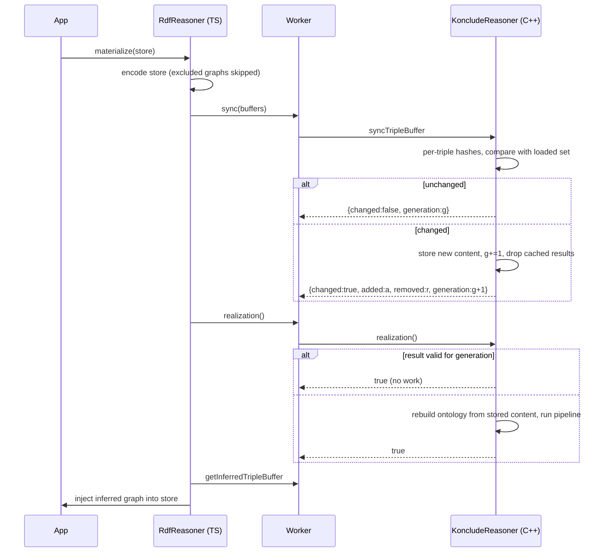

# refactor: Self-invalidating C++ reasoner API and thin TS layer

## Overview

Move all "is my cached result still valid?" logic into the C++ reasoner. The caller hands over the quads of its N3 store (encoded as today); C++ decides by itself whether the content changed since the last call and invalidates cached classification / realization results when it did. Repeated calls on unchanged content cost nothing; changed content triggers a safe rebuild inside C++. The TS layer shrinks to quad <-> buffer conversion, store persistence and result injection.

Konclude's own incremental threads are paused (see `docs/solutions/architecture-patterns/konclude-native-incremental-revisions.md`: upstream concept realizer is a stub, incremental precomputation crashes on freed revision data). Speed therefore comes from result caching plus a robust rebuild, not from incremental kernel work. The design keeps the door open for the later own-incremental-realizer task (option 3) by retaining a per-triple digest set that yields exact added/removed deltas.

## Problem Frame

Today `ts/index.ts` computes a content fingerprint by reading N3 private fields (`computeStoreFingerprintDirect` in `ts/n3Inject.ts`), keeps six per-operation caches keyed by store identity plus fingerprint, and the worker (`ts/worker.ts`) unconditionally calls `reset()` on every `loadTripleBuffer`. Consequences:

- Two `Store` objects with identical quads miss the cache and trigger a full reset+reload (the `warmup-sequential` "second call, different store instance" case).
- The reset+reload path still has the sequential-call defects (Nth-rebuild hang, corrupt result buffer on the second call). All 10 remaining suite failures are this class (`docs/solutions/debugging/wasm-suite-status-2026-10-09.md`).
- Cache validity is decided in TS from private N3 internals, duplicated across six caches, and fragile against N3 upgrades.

The user requirement: C++ notices store changes itself, without the caller stating what changed. This plan refines origin plan units U6/U7 into Units 1-6 below (the origin's U8, reflexive delta, is unchanged and deferred).

## Requirements Trace

- R1. C++ detects added/removed quads by comparing the content handed in with the content of the loaded state; callers never signal "changed".
- R2. `classification()` and `realization()` are idempotent: on unchanged content they return the cached result without running Konclude; on changed content they rebuild and recompute.
- R3. Content identity is independent of `Store` object identity, quad order, and duplicate quads; excluded graphs (inferred, explanation, hypothetical) never count as changes.
- R4. Rebuild after a change is robust over long sequences (the failing sequences in `hang-minimal`, `warmup-sequential`, `hang-debug`, `property-characteristics`, `explanation-perf` complete).
- R5. The public `RdfReasoner` TS API (`classify`, `materialize`, `classifyProperties`, `checkConsistency`, `explain*`, `whatIf`, `validate`) keeps its signatures and results; caches inside TS that depend on N3 private fields are removed.
- R6. Output equals the oracle: `make repro-wasm` still shows only the documented delta; full suite green apart from explicitly rewritten tests.
- R7. Exact added/removed counts (and the triples) of the last change are observable for diagnostics and for the future incremental task.
- R8. Rebuild failures are recoverable: a failed or interrupted lazy rebuild never serves a stale result under the new content; the next call retries.

## Scope Boundaries

- No incremental Konclude threads, no revision chains (paused; see origin doc and experiments in `docs/experiments/`).
- No multi-slot cache of several ontologies at once (single loaded state; switching content = rebuild). Called out in Future Considerations.
- No change to reasoning semantics, patches 000-020, or the wire format of result buffers.
- Browser-specific worker packaging (`ts/inlineWorker.ts`) is not redesigned; it only has to keep working.

### Deferred to Separate Tasks

- Own incremental classification/realization (option 3): separate plan, resumes from `docs/experiments/README.md`.
- Reflexive-pair delta (U8 in the origin plan).
- Multi-ontology LRU (needed only if `whatIf`-heavy workloads on large data prove too slow).

## Context & Research

### Relevant Code and Patterns

- `src/KoncludeReasoner.h`, `src/KoncludeReasoner.cpp`: `Impl` holds all state; `Impl::reset()` rebuilds a fresh `CConcreteOntology` and clears index maps; `runPipeline()` runs classification/realization requirement lists; `loadTripleBuffer()` decodes the binary buffer into librdf and calls `mapTriples()`. Native-only `loadNTriplesStr` is the harness entry.
- `src/bindings.cpp`: Embind surface (flat list of `.function` entries).
- `ts/worker.ts`: typed dispatch; `loadTripleBuffer` case calls `r.reset()` first (to be removed).
- `ts/index.ts`: `_queue` serialisation, per-op caches `_classifyCache`, `_materializeCache`, `_consistencyCache`, `_classifyPropertiesCache`, `_lastExplBuffer`, `_lastPropertyExplBuffer`, keyed by `computeStoreFingerprintDirect(store)` + store identity.
- `ts/intern.ts` (`encodeToBuffers`, `InternTable`, wire format with top-2-bit term types), `ts/n3Inject.ts` (`encodeStoreToBuffers`, `EXCLUDED_GRAPHS`, `clearGraph`).
- `src/native_repro.cpp`: native harness with modes `reuse`, `reload-split`, `incr-abox`, default reset loop; `scripts/repro-sample.sh`, `scripts/wasm-sample.sh` (`make repro-wasm`).
- Failing sequences to reproduce natively: `tests/integration/hang-minimal.test.ts` (empty materialize, empty classify, roberts x2, mini classify, roberts classify, roberts materialize), `tests/integration/warmup-sequential.test.ts`.

### Institutional Learnings

- `docs/solutions/debugging/sequential-call-object-lifecycle.md`: processing-end/start message sets grew across `reset()`; stopped realizers; patches 009/011 address parts.
- `docs/solutions/architecture-patterns/konclude-native-incremental-revisions.md`: why no incremental threads.
- `docs/solutions/best-practices/native-debug-pipeline-playbook.md`: use the native harness for correctness/hang hunts; never `pkill -f`; save vitest output to a file first.
- Memory: Konclude item lifecycle paradigm ("keep while valid, free on change"; delete stale items at the START of the next call, never at finish), manager-thread singleton pattern (use `reset()` not `destroyReasoner()`), one Worker per test file (pthread pool).

### External References

- None needed; local patterns are strong and the work is internal.

## Key Technical Decisions

- **Fast fixtures by default, Roberts only as a gate.** All iteration (harness sequences, contract tests, benchmarks) uses small fixtures: `tests/fixtures/mini-family.nt` (161 triples, ABox with roles, realization in under a second), `tests/fixtures/lubm.nt` (307 triples), `tests/fixtures/pizza.nt`, `tests/fixtures/kpset-tbox.nt`, `tests/fixtures/unsatisfiable-class.nt`, `tests/fixtures/inconsistent.nt`, `tests/fixtures/pc-*.nt`, plus programmatically generated variants (one triple added or removed, shuffled order, duplicated quads, relabelled blank nodes). Roberts (3.9k triples, ~35 s per realization) is used only for (a) one 7-step confirmation sequence at the end of Unit 1 because the old hangs may depend on size and heap state, (b) the oracle parity check (`make repro-wasm`) and (c) one unchanged-repeat plus one-triple-add pair in Unit 5/6. `galen.nt`/`lubm-data.nt` are the large-store inputs for encode-cost and memory measurements only.

- **C++ owns validity, TS only ships content.** TS encodes the store (minus excluded graphs) on every public call and calls `sync`. Rationale: removes dependence on N3 private internals and satisfies R1/R3. Cost is one encode per call; U5 measures it against typical call times (tens of ms vs seconds) and decides whether a TS-side "unchanged since last encode" hint is worth adding (as an optimisation only; C++ stays authoritative).
- **Content digest = set of per-triple 128-bit hashes.** Each triple hash mixes the term type tag (taken from the top 2 bits of the triple id, since the string table holds no type), a separator, and the hash of the decoded term string (literals normalised exactly like the loader's decoder: `value\0datatype\0lang`, language segment optional). Call-local interned ids never enter the hash. The digest is a set (duplicates collapse; the "count" is the set size). The "unchanged" decision uses full set equality on the 128-bit hashes, never a sum/xor shortcut (linear combinations collide trivially). Keeping the set (about 16 bytes per triple, ~6 MB for 350k) yields exact deltas for R7. Blank-node labels count as content (a re-parsed store with fresh labels is a change; conservative and safe; U5 verifies label stability for the repo's parse paths and `urn:vg:bnode:` skolemisation).
- **Lazy rebuild with an atomic `loaded` state.** `sync` only records the new content and invalidates. The Konclude ontology and all load-derived side tables (`mWorkaroundJustifications`, `mSvfIndex`, `mDifferentFromPairs`, `mMinCardRestrictions`, `mOneOfMemberships`, `mFpIfpSameAsPairs`, `mTriviallyInconsistent`, index maps, result buffers) form one `Impl::loaded` struct (content buffers + string table together, since ids are only valid with the string table of the same call, variant, derived tables) that is replaced atomically by `buildOntology(content, variant)`. `reset()` is invoked only when an ontology was actually built (`built` flag), so first loads and no-op syncs never touch it. Retained content is released after a successful build (the digest set stays); a failed build keeps it so the next call retries (R8).
- **Per-operation result retention.** C++ keeps one result buffer per operation family (classification, realization, properties) per generation; reads return the retained buffer, so a fresh `Store` with identical content is served by re-injecting the cached buffer into that store's (cleared) inferred graph, not by recomputation and not by a silent no-op. `materialize` after `classify` on the same generation reuses the classification, adds the realization buffer, and does not discard the classification buffer.
- **Load variant is part of the cache key.** `forRealization` is not a build detail: it enables the functional/inverse-functional pre-scan (`src/KoncludeReasoner.cpp` around the `fpPreRdfTypeIdx` block) that drops FP/IFP declarations from the loaded TBox and fills `mFpIfpSameAsPairs`/`mWorkaroundJustifications`, and classify/consistency deliberately keep native IFP semantics. So a realization build is not a valid classification build. `classification()` is a no-op only when the loaded variant matches the requested one; realize-after-classify rebuilds once with the realization variant; classify-after-realize rebuilds once with the classification variant. U2 first measures whether both variants give identical classification output over all fixtures; if they do, the realization variant becomes the single variant and the extra rebuilds disappear (decision recorded in U2, table updated accordingly).
- **Rebuild failure state (R8).** Generation and digest are committed at `sync`; `built` and per-op results are not. If `buildOntology` or the pipeline fails or the watchdog trips, `built=false`, results stay invalid, and the next ensure call retries from the retained content; the old results are never served for the new generation. Watchdog/timeout inside WASM is a caller-visible error (no core dump available); the native harness keeps `--core-after`.
- **Explicit ensure verbs, implicit invalidation.** Reads and the existing verbs `classification()`, `realization()`, `consistency()` stay as the "ensure level" calls, now idempotent per generation. Invalidation is never a caller concern. Reads on a stale generation return the same empty/not-classified results as today for "not classified" (no silent recomputation inside read accessors).
- **Generation counter.** C++ increments a `generation` on every content change and exposes it; TS keys derived result caches (explanation buffers, unsatisfiable-class lists) on it instead of fingerprints.
- **Load variant.** Ontology is built with the realization loader variant (`forRealization=true`) whenever realization is requested; if a classification-only request comes first and realization later, rebuild once. U2 verifies whether the variant changes classification output; if it does not, always build the realization variant.
- **`whatIf`/`explain` rebuild cost is a measured trade-off, not a silent regression.** Today each hypothetical load already pays one full reload and the next real call another; the new design is not worse per call, but it makes `whatIf` loops depend on rebuild robustness. U5 benchmarks `whatIf` (10+ iterations) and the candidate-probe loops (`explain*`, laconic justification, entailment probes). If a loop regresses, a two-slot design (current + previous digest and results) is pulled forward from Future Considerations.
- **Rebuild robustness is a gate.** Because change-driven rebuild still uses the reset path, the Nth-rebuild hang must be reproduced natively and in WASM and fixed before the TS layer is switched over (U1 before U3). Exit criterion: a 50-rebuild mixed sequence completes natively (N>=5 fresh processes) and under WASM (multi-process, `make repro-wasm`-style), with bounded RSS. Decision owner: the user, after U1's report; if the criterion cannot be met, U2/U3 still ship the cache-only behaviour behind the same API, and R4 stays open with a documented sequence limit.

## Open Questions

### Resolved During Planning

- Who decides "changed"? C++ (digest compare in `sync`), per the user requirement.
- Is a diff needed for correctness? No; exact deltas are exposed for diagnostics/future incremental work only. Any change invalidates everything.
- Keep `forRealization` flag? Replaced by the lazily chosen load variant (see decisions).

### Deferred to Implementation

- Whether the Nth-rebuild hang is in the reset path (processing sets, stopped realizers, BackendAssCache, caches holding raw pointers to `mPreviousPreviousOntology`) or in test ordering; U1 finds out natively.
- Exact hashing function (any stable 64-bit string hash; seed fixed so digests are comparable within a process; no persistence across processes needed).
- Whether the TS encode cost for 350k-triple stores warrants the optional TS-side pre-check.
- Exact shape of the diagnostics returned by `sync` (counts versus triple lists; lists only on request to avoid copying).

## High-Level Technical Design

> *This illustrates the intended approach and is directional guidance for review, not implementation specification. The implementing agent should treat it as context, not code to reproduce.*

Cache state per generation in C++ (variant column applies unless U2 settles on a single load variant):

| State | classification() | realization() | consistency() |
|-------|------------------|---------------|---------------|
| content synced, nothing built | build (classification variant) + classify | build (realization variant) + realize | build + check |
| built for classification, same generation | no-op | rebuild once with realization variant + realize | no-op if checked |
| built for realization, same generation | rebuild once with classification variant (no-op if single variant) | no-op | no-op if checked |
| content changed (generation+1) | invalidate, then as first row | invalidate, then as first row | invalidate, then as first row |
| build failed after sync | retry build from retained content | retry | retry |

## Implementation Status (2026-10-10 evening)

Done: Units 1-4, 6 (commits b4c7fbf..3c14f61). Unit 5 partial: `tests/integration/self-invalidating-cache.test.ts` written and passing, old hang-* tests deleted; NOT done: encode-cost benchmark (`tests/bench/encode-cost.bench.ts`), whatIf x10 / probe-loop timing, Roberts oracle check (`make repro-wasm N=8`), memory-rss-regression run.
Deviations: single wire name `sync` (alias `loadTripleBuffer` in worker); variants kept separate (U2 variant-equality measurement skipped, conservative); no per-op result retention (classify<->materialize switch rebuilds once); Worker recycle moved to "changed content only"; retained content is kept (not released) to allow variant rebuilds.
Extra root cause fixed: negative Embind pointers above 2 GiB (worker `>>> 0`).

## Implementation Units

- [x] **Unit 1: Native rebuild-sequence harness and Nth-rebuild robustness (gate)**

**Goal:** Reproduce the sequential failures natively through the reset/rebuild path and make long change sequences complete. Characterization first.

**Requirements:** R4, R6

**Dependencies:** None

**Files:**
- Modify: `src/native_repro.cpp` (new mode `seq` taking an ordered op list: `materialize <fixture>`, `classify <fixture>`, `props <fixture>` with a different fixture per step)
- Modify: `src/KoncludeReasoner.cpp` (only fixes found by the harness, shipped as patches/overrides per project rules)
- Create: `scripts/seq-sample.sh` (fresh-process runs of the failing sequences, mirrors `scripts/repro-sample.sh`)
- Create: `scripts/wasm-seq-sample.mjs` (same sequences through the WASM build via `RdfReasoner`, one Node process per sample; the hangs were pthread-pool behaviours native runs may not reproduce)
- Test: harness runs are the test; later mirrored in `tests/integration/self-invalidating-cache.test.ts` (Unit 5)

**Approach:**
- Encode the `hang-minimal` and `warmup-sequential` call orders as harness sequences using existing fixtures (`tests/fixtures/`), plus a long alternating sequence (20+ steps, mixed ontologies) to flush out leaks and stale-set growth.
- Use `dumpState` counters (processing sets, stopped realizers) and the playbook (watchdog abort, gdb all-thread backtrace) to locate the defect. Candidates from learnings: message sets not cleared (patch 009 exists), stopped realizers, caches holding raw pointers to ontologies that `reset()` frees.
- Follow the item-lifecycle rule: free stale items at the start of the next call.
- Any vendor change goes through `scripts/new-multi-file-patch.sh` (never `new-vendor-patch.py`); graphify before any C++ patch (mandatory per project rules).

**Execution note:** Characterization-first: land the failing sequence reproduction before changing C++.

**Patterns to follow:**
- `--mode reuse` and `reload-split` in `src/native_repro.cpp`; `scripts/repro-sample.sh`.

**Test scenarios:**
- Happy path: the hang-minimal call order, with mini-family standing in for Roberts, completes natively and under WASM with identical output for repeated steps; the same order with real Roberts runs once at the end as a confirmation.
- Edge case: 50-step alternating sequence (mini-family, lubm, pizza, empty, mini-family-with-one-triple-removed, mini-family-with-one-triple-added) completes in seconds; process RSS growth per cycle stays bounded.
- Error path: a step exceeding the watchdog timeout is reported as HANG with a core, not silently skipped.
- Integration: output of every step equals a from-scratch run of the same fixture (a fresh process per fixture is the reference); Roberts steps additionally equal the oracle fingerprint (`scripts/compare-fingerprint.py`).

**Verification:**
- `seq` runs of all failing sequences complete in fresh processes (N>=5), natively and under WASM, with oracle-equal output; counters in `dumpState` do not grow unboundedly; the exit criterion above is met or the user decides on the fallback.

- [x] **Unit 2: C++ content digest, `sync`, generation and idempotent ensure**

**Goal:** Implement self-invalidation inside `KoncludeReasoner`: digest set, change detection, generation counter, lazy rebuild, idempotent `classification()` / `realization()` / `consistency()`.

**Requirements:** R1, R2, R3, R7, R8

**Dependencies:** Unit 1 (rebuild must be robust)

**Files:**
- Modify: `src/KoncludeReasoner.h`, `src/KoncludeReasoner.cpp` (new `Impl` fields: digest set, `loaded` struct, pending content, generation, per-op result buffers, `built` flag; split the current `loadTripleBuffer` into `decode` / `hash` / `buildOntology(content, variant)`)
- Modify: `src/native_repro.cpp` (new native-only `syncNTriplesStr`, mode `sync-scenarios`)
- Test: harness scenarios (below); unit-level C++ checks are exercised through the harness

**Approach:**
- Fast path: a diagnostics-off mode skips building added/removed lists (probe loops call `sync` thousands of times with small candidate sets). `syncTripleBuffer` decodes the string table once, computes the hash per (type tag, term string), derives triple hashes, builds the new set, compares with the loaded set. Unchanged: return without touching state. Changed: compute exact added/removed counts, keep the new content buffers (copy) for the lazy load, bump `generation`, clear done flags and cached result buffers.
- The existing decode+`mapTriples` code and all per-load derived tables move behind `buildOntology`, driven by `ensureBuilt(variant)`; stale per-generation state (`mResultBuffer`, tag maps) is cleared at the START of the next ensure call (item-lifecycle rule). `consistency()` is memoised per generation (it is not today).
- `classification()`/`realization()`/`consistency()` check generation-scoped done flags before running `runPipeline`.
- Decide the load variant first (see Key Technical Decisions): compare classification output of both variants over `tests/fixtures/` natively and record the result.
- Expose `generation()` and last-sync stats (`changed`, `added`, `removed`, tripleCount); lists of added/removed hashes only via a native/debug accessor.

**Patterns to follow:**
- `Impl::mTriviallyInconsistent`-style per-generation flags; existing `WASM_TRACE1` logging for state transitions.

**Test scenarios:**
- Happy path: sync A, realize, sync A again (same buffer) -> `changed=false`, `realization()` returns instantly, generation unchanged, result buffer identical.
- Happy path: sync A, realize, sync A' (one ABox triple added) -> `changed=true`, `added=1, removed=0`, generation+1; `realization()` recomputes and output equals a from-scratch run of A'.
- Edge case: same quads in different order, with duplicates, interned with different ids -> `changed=false`.
- Edge case: add a triple then remove it again before any reasoning call -> loaded-vs-pending comparison yields `changed=false` and no rebuild happens (verify via rebuild counter).
- Edge case: empty content, single triple, and a large store (`lubm-data.nt`, ~100k triples) sync time stays negligible relative to reasoning.
- Edge case: blank-node label change counts as a change (documented).
- Error path: null/short buffers leave state untouched and report an error code, not a crash.
- Integration: classify then realize on the same generation rebuilds once (or reuses, if the single-variant decision holds), never twice; realize then classify is a no-op only if the variant decision allows it.
- Error path: inject a failure in `buildOntology` -> next `realization()` retries from retained content and does not serve old results; generation and digest unchanged by the retry.
- Edge case: two identical `getInferredTripleBuffer` calls return the same buffer; `classify` result buffer survives a following `materialize` on the same generation.
- Edge case: term hashing distinguishes an IRI and a literal with the same string.

**Verification:**
- Native `sync-scenarios` all pass; generation and rebuild counters match expectations; oracle equality for Roberts after one sync/changed/unchanged sequence (all other scenarios on small fixtures); classification output identical across load variants (or the variant split is implemented and covered); peak heap with retained content measured via `tests/integration/memory-rss-regression.test.ts`.

- [x] **Unit 3: Embind surface and worker protocol**

**Goal:** Expose the new API to JS and remove the unconditional reset from the worker.

**Requirements:** R1, R2, R5

**Dependencies:** Unit 2

**Files:**
- Modify: `src/bindings.cpp` (`syncTripleBuffer`, `generation`, `syncStats`; keep verbs and reads)
- Modify: `ts/worker.ts` (`sync` message replaces `loadTripleBuffer`+`reset`; keep `reset` only for explicit teardown/tests), `ts/konclude.mjs` typings or the declaration file used by the worker if present
- Modify: `ts/inlineWorker.ts` (mandatory: it duplicates the whole `loadTripleBuffer` handler including `reset()` and `forRealization`)
- Modify: `ts/konclude.d.mts` (Embind typings for the new methods)
- Test: `tests/unit/worker.test.ts` and the integration tests in Unit 5

**Approach:**
- Keep message names stable where possible; `loadTripleBuffer` is replaced by `sync` returning `{changed, added, removed, generation}`; the old `forRealization` argument disappears.
- `reset()` stays exported (explicit memory release) but is no longer part of normal call flow.

**Patterns to follow:**
- Existing typed dispatch and transfer-list handling in `ts/worker.ts`.

**Test scenarios:**
- Happy path: worker `sync` with unchanged buffers returns `changed:false` and takes under a few milliseconds beyond decode.
- Error path: unknown method still returns `Unknown method` error response.
- Integration: transferred buffers are neutered after `sync` and the worker does not read them afterward.

**Verification:**
- Worker unit tests pass; `npm run build` compiles; smoke test (`make smoke`) passes after WASM rebuild in Unit 6.

- [x] **Unit 4: Thin TS layer**

**Goal:** Replace fingerprint/identity caches with `sync` + generation; keep public API behavior.

**Requirements:** R3, R5

**Dependencies:** Unit 3

**Files:**
- Modify: `ts/index.ts` (`_sync(quads)` over `Quad[]` so the probe call sites that bypass `Store` (`whatIf`, entailment probes, laconic justification: the `_callDirect`/`loadTripleBuffer` sites near the lines that currently pass `fingerprint=null`) use the same path; remove `_classifyCache`, `_materializeCache`, `_consistencyCache`, `_classifyPropertiesCache` and fingerprint plumbing; key `_lastExplBuffer`/`_lastPropertyExplBuffer` on the C++ generation; all public ops call one private `_sync(store)` first)
- Audit before deleting caches: `tests/integration/incremental-reasoning.test.ts`, `tests/integration/consistency.test.ts`, `tests/integration/explanation-persistence.test.ts`, `tests/unit/RdfReasoner.store.test.ts` for assertions on cache-hit behaviour, delta semantics and custom inferred graphs; list required rewrites in this unit.
- Modify: `ts/n3Inject.ts` (drop `computeStoreFingerprintDirect` and its dependence on N3 private internals, keep `encodeStoreToBuffers`, `EXCLUDED_GRAPHS`, `clearGraph`, injection helpers)
- Modify: `ts/types.ts` (only if a diagnostics type is exposed)
- Test: `tests/unit/` cases touching removed helpers (`n3Inject` fingerprint tests are removed or replaced)

**Approach:**
- `_sync(store)` clears the inferred graph (existing behavior) before encoding so inferred triples never count as content, encodes minus excluded graphs, sends `sync`, returns the generation.
- `whatIf` / `explain*` / `validate` keep composing the same primitives; hypothetical stores simply cause a content change and (lazy) rebuild; returning to the original store changes content back and triggers one rebuild (accepted; see Future Considerations).
- Delete code that exists only to compare fingerprints; keep `this._queue` serialisation.

**Patterns to follow:**
- Existing `_call`/`_callDirect` and `_queue.then(...)` flow in `ts/index.ts`.

**Test scenarios:**
- Happy path: `materialize(storeA)` then `materialize(storeB)` where `storeB` is a fresh `Store` with identical quads -> second call performs no Konclude work (observable through worker `syncStats`/timing); `storeB`'s inferred graph is populated by re-injecting the retained result buffer and equals `storeA`'s.
- Edge case: `returnDelta` after a no-op C++ call on a store whose inferred graph was cleared in `_sync` reports the correct delta (not empty); custom `inferredGraph` IRIs keep working.
- Happy path: `classify(store)`, add a quad, `classify(store)` again -> second result reflects the new quad without the caller signalling anything.
- Edge case: inferred/explanation graph quads in the store never trigger invalidation.
- Edge case: concurrent calls on one `RdfReasoner` remain serialised and consistent.
- Error path: encode failure or worker error leaves C++ state at the last successfully synced content.
- Integration: `explain` after `materialize` on the same content reuses the generation-keyed explanation buffer.

**Verification:**
- No remaining references to `computeStoreFingerprintDirect`; full TS unit suite and integration suites touching public API pass.

- [~] **Unit 5: Rewrite sequential tests and measure encode cost**

**Goal:** Replace the old reset+reload sequence tests with tests for the self-invalidating contract; measure whether TS encode cost needs an optimisation.

**Requirements:** R2, R3, R4, R6, R7

**Dependencies:** Units 3, 4 (WASM rebuild and final verification are Unit 6)

**Files:**
- Create: `tests/integration/self-invalidating-cache.test.ts` (new contract tests, one Worker per file)
- Delete (untracked experiments): `tests/integration/hang-debug.test.ts`, `tests/integration/hang-empty3.test.ts`, `tests/integration/hang-minimal.test.ts`, `tests/integration/warmup-sequential.test.ts`; their scenarios live on as sequences in the new file
- Modify: `tests/integration/property-characteristics.test.ts` (keep the nine cases; they now share one reasoner without the call-8/9 hang), `tests/integration/explanation-perf.test.ts` (keep threshold; re-measure first), `tests/integration/explanation-persistence.test.ts` (flaky "kj:axiom quads" case: confirm stable)
- Create: `tests/bench/encode-cost.bench.ts` (or script) measuring `encodeStoreToBuffers` plus `sync` for large stores (`lubm-data.nt`, `galen.nt`) AND small-candidate probe loops (`whatIf` x10+, laconic/entailment probes), with a go/no-go threshold for the optional TS pre-check; first measurement happens right after Unit 2 on the native side so the design can change before Unit 4
- Test: `tests/integration/memory-rss-regression.test.ts` (run to verify retained-content overhead)

**Approach:**
- Contract tests use mini-family/lubm/pizza for speed; one Roberts materialize pair (unchanged repeat, one-triple add) covers the heavy path.
- The explanation-perf ratio is re-measured on the new binary before any threshold decision (the earlier failure was a corrupt buffer on call 2, not timing).

**Test scenarios:**
- Happy path: repeat `classify`/`materialize`/`checkConsistency` on unchanged and on re-created stores -> no recomputation, identical outputs.
- Happy path: add quad -> invalidates; remove quad -> invalidates; add+remove back before the next call -> no recomputation.
- Edge case: 12+ alternating calls across 3 ontologies (the former call-7 and call-8/9 hang positions) complete.
- Edge case: inferred-graph quads present in the store from a previous `materialize` do not cause invalidation on the next call.
- Error path: reasoning call after a failed sync does not use stale content.
- Integration: `whatIf` with additions, then the original store again, returns to the original result; loop of 10+ `whatIf` calls stays within the benchmark budget.
- Edge case: re-parsed Turtle of the same file yields identical blank-node labels (or the doc records that it does not).
- Integration: results stay oracle-equal (`make repro-wasm`) after a sequence of unchanged/changed calls in one process.

**Verification:**
- New and rewritten suites pass; the 7 former sequential-call failures, the 2 `property-characteristics` failures (calls 8-9) and the `explanation-perf` failure are gone; the encode-cost measurement is recorded in the plan/doc with a decision on the optional TS pre-check.

- [x] **Unit 6: WASM rebuild, verification, documentation**

**Goal:** Ship the change and record it.

**Requirements:** R5, R6

**Dependencies:** Units 1-5

**Files:**
- Modify: `docs/solutions/architecture-patterns/konclude-native-incremental-revisions.md` (link), `CLAUDE.md` (architecture section: new JS<->WASM contract, `sync` + generation, removal of reset+reload), `README.md` / API docs if they describe call flow
- Create: `docs/solutions/architecture-patterns/self-invalidating-reasoner-api-2026-10-10.md` (contract, digest design, failure modes, how to extend for incremental)
- Rebuild: `make build-wasm` then `npm run patch-wasm`, `npm run build`

**Approach:**
- Full-suite run saved to a file first, then tail; `make repro-wasm N=8` for oracle parity; `make smoke`.
- Update memory notes and write the ce-compound entry afterwards.

**Test scenarios:**
- Test expectation: none -- documentation and release verification; covered by suites from Units 1-5.

**Verification:**
- Full suite green apart from deliberately retired tests; `make repro-wasm N=8` shows only the documented reflexive delta; docs and CLAUDE.md describe the new contract.

## System-Wide Impact

- **Interaction graph:** every public `RdfReasoner` method funnels through `_sync`; `whatIf`/`explain*`/`validate` compose them; worker dispatch loses `reset` from the hot path.
- **Error propagation:** a failed `sync` must leave the previously synced content and cached results intact; reasoning calls never run on half-synced content.
- **State lifecycle risks:** retained content buffers double memory for large stores (roughly tens of MB for 350k triples, plus 3 MB digest set); ontology rebuild still frees the previous ontology per the item-lifecycle rule (Unit 1 audit). Lazy rebuild must not leave raw pointers in caches to freed ontologies.
- **API surface parity:** Node CLI (`ts/cli.ts`), browser worker (`ts/inlineWorker.ts`), `ts/index.node.mjs` postbuild rewrite all use the same worker protocol; method renames must be mirrored.
- **Integration coverage:** cross-layer sequences (store mutation -> sync -> invalidate -> recompute -> inject) are covered by Unit 5 integration tests that unit tests with mocks cannot prove.
- **Unchanged invariants:** public TS signatures, result buffer wire format, inferred/explanation/hypothetical graph IRIs, patches 000-020, oracle output.

## Risks & Dependencies

| Risk | Mitigation |
|------|------------|
| Nth-rebuild hang is deeper than known and blocks the whole plan | Unit 1 is a gate (native and WASM, 50-rebuild criterion); if unmet the user decides; fallback ships the cache-only behaviour behind the same API and documents the sequence limit (R4 stays open) |
| Encode cost on every call hurts small interactive calls | Measure in Unit 5; add an optional TS-side "same store object, no mutation since last encode" hint only if needed; C++ remains authoritative |
| Hash collision yields a wrongly cached result | 128-bit triple hashes with type tag and separators, full set equality (no sum/xor shortcut); accepted and documented |
| Blank-node relabeling causes needless rebuilds | Conservative by design; document; N3 parsers usually give stable labels per parse |
| Retained buffers raise peak memory in WASM (INITIAL_MEMORY 1 GB; peak = old content, new content, librdf model, two ontologies) | Release content after a successful build (Unit 2), measure with `tests/integration/memory-rss-regression.test.ts` |
| Lazy rebuild fails or hangs after sync committed | R8 retry semantics; test in Unit 2; WASM has no core dump, so the watchdog error path is covered by a harness case |
| Changing the worker protocol breaks the browser inline worker | Mirror changes in `ts/inlineWorker.ts`; run `tests/browser` where available |

## Documentation / Operational Notes

- Add the new contract to `CLAUDE.md` (JS<->WASM bridge section) and a solutions doc; update memory notes (`project-incremental-realization-paused` already links the future incremental work).
- After shipping: ce-compound entry capturing the self-invalidating design and the Nth-rebuild fix.

## Future Considerations

- Multi-slot ontology cache (LRU of 2-3 loaded states) to make `whatIf` on large stores cheap; needs a pthread-pool and memory budget.
- Own incremental realization (option 3): `sync` already yields exact added/removed triple sets; classify whether a change touches schema (rdf:type of classes/properties, subClassOf, domain/range, ...) versus ABox-only to select a reuse path.

## Sources & References

- **Origin document:** `docs/plans/2026-10-09-001-fix-remaining-work-after-realization-fix-plan.md` (units U6, U7)
- Incremental status: `docs/solutions/architecture-patterns/konclude-native-incremental-revisions.md`, `docs/experiments/README.md`
- Failure triage: `docs/solutions/debugging/wasm-suite-status-2026-10-09.md`
- Lifecycle learnings: `docs/solutions/debugging/sequential-call-object-lifecycle.md`
- Code: `src/KoncludeReasoner.cpp`, `src/bindings.cpp`, `ts/worker.ts`, `ts/index.ts`, `ts/n3Inject.ts`, `ts/intern.ts`
